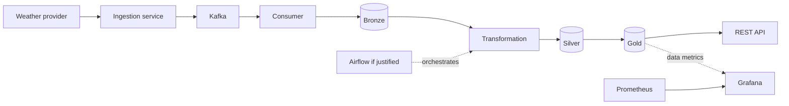

# Architecture

**Status:** Proposed, not implemented.

Bronze preserves source payloads and ingestion metadata; silver normalizes units, timestamps and identifiers; gold serves curated aggregates and API queries. The three databases initially share a PostgreSQL instance. PostgreSQL does not support ordinary cross-database joins; evaluate application-mediated transfer or other justified mechanisms. Compare with schemas in one database before finalizing.

Use UTC internally, distinguish forecast issue time from valid time, and retain source provenance. Define natural keys, duplicate handling, late data, schema evolution, retry boundaries and replay semantics before implementation. Kafka is not a guarantee of end-to-end exactly-once processing.

Start with a minimal vertical slice, then add Kafka and service boundaries. Compose networks, persistent volumes, health checks and resource limits must be documented. Keep databases and brokers off public interfaces by default. Prometheus collects operational metrics; Grafana visualizes and alerts using Prometheus and PostgreSQL where appropriate.

## Decisions to validate
Source contract and cadence; event format and keys; database boundaries; retention and backup; orchestration; service ownership; API access; metrics and SLOs; resource usage. No numerical targets are agreed yet.
